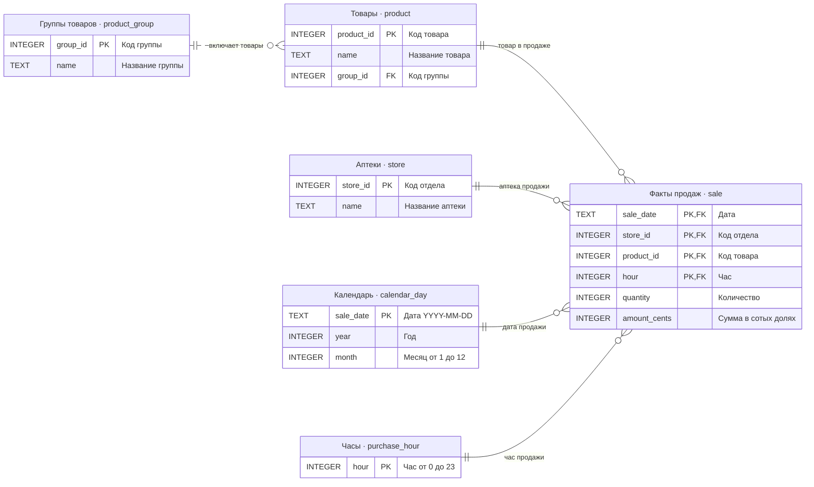

# Схема базы данных «Фармация»

ER-диаграмма показывает физическую структуру SQLite-базы `pharma.sqlite`. Названия полей и типы совпадают с [SQL-схемой](./schema.sql).

**PK** — первичный ключ. **FK** — внешний ключ. Каждая строка продаж ссылается ровно на одну дату, аптеку, товар и час. Каждая запись справочника может относиться к нескольким продажам или пока не использоваться.

### Как устроены данные

- **Одна строка продаж** содержит итог за конкретные дату, аптеку, товар и час. Вместе эти четыре поля образуют первичный ключ.
- **Количество и сумма** — факты. Сумма хранится целым числом в сотых долях денежной единицы, чтобы складывать суммы без ошибок округления.
- **Схема «снежинка».** Группа связана с товаром через `product.group_id`. В отчётах категорию каждой продажи можно получить по цепочке «Продажа → Товар → Группа».

### Данные для Loginom

| Представление | Назначение |
|---|---|
| `sales_for_cube` | Продажи с названиями аптек, товаров и групп, годом и месяцем. |
| `sales_latest_four_months` | Срез за последние четыре календарных месяца относительно даты последней продажи. |
| `sales_by_month` | Итоги по месяцам, аптекам и группам товаров. |
